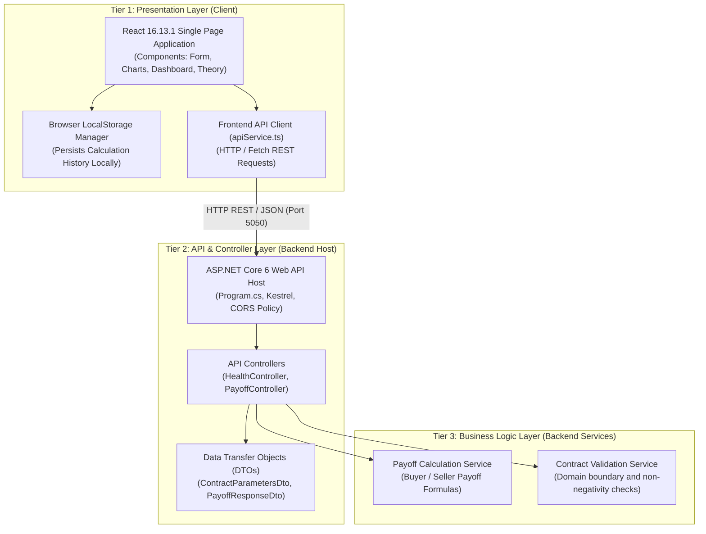

# Forward Contract Profit/Loss Calculator

[](https://uom.lk)
[](https://uom.lk)
[](https://reactjs.org)
[](https://dotnet.microsoft.com)
[-success.svg)](#3-layered-architecture-n-tier)

An interactive full-stack financial engineering workspace developed for the **IS4350 Financial Engineering** group assignment at the **University of Moratuwa**. The application models, calculates, and visualizes buyer (long) and seller (short) payoff distributions for forward contracts at maturity under varying market spot conditions.

---

## Table of Contents
1. [Project Overview](#1-project-overview)
2. [Technology Stack & Versions](#2-technology-stack--versions)
3. [Layered Architecture (N-Tier)](#3-layered-architecture-n-tier)
4. [Project Directory Structure](#4-project-directory-structure)
5. [Team Responsibilities & Project Roadmap](#5-team-responsibilities--project-roadmap)
6. [Developer Prerequisites](#6-developer-prerequisites)
7. [Clone & Installation](#7-clone--installation)
8. [Running the Application](#8-running-the-application)
9. [Local URLs & API Contract](#9-local-urls--api-contract)
10. [Environment Variables & Persistence](#10-environment-variables--persistence)
11. [Git Branching & Pull Request Workflow](#11-git-branching--pull-request-workflow)
12. [Troubleshooting Guide](#12-troubleshooting-guide)
13. [Production Deployment Readiness & Hosting Options](#13-production-deployment-readiness--hosting-options)

---

## 1. Project Overview

A **Forward Contract** is a customized bilateral financial derivative where counterparties lock in a transaction for an underlying asset at an agreed forward price ($K$) on a specified future expiration date ($T$). No initial cash outlay or premium is paid at inception ($t = 0$), and the contract represents a zero-sum payoff structure between buyer and seller.

### Core Mathematical Payoff Model
- **Agreed Forward Price ($K$)**: Delivery price agreed at contract inception.
- **Market Price at Maturity ($S$)**: Spot market price of the asset at expiration date.
- **Contract Quantity ($Q$)**: Total volume of units transacted.

$$\text{Payoff}_{\text{Buyer (Long)}} = (S - K) \times Q$$

$$\text{Payoff}_{\text{Seller (Short)}} = (K - S) \times Q$$

$$\text{Net System Payoff} = \text{Payoff}_{\text{Buyer}} + \text{Payoff}_{\text{Seller}} = 0$$

---

## 2. Technology Stack & Versions

The project follows a **Layered Full-Stack Architecture** with strict version constraints:

| Layer | Technology | Version | Purpose |
| :--- | :--- | :--- | :--- |
| **Frontend Framework** | React & React DOM | `16.13.1` | Single-page UI application (SPA) |
| **Language (Client)** | TypeScript | `~4.9.5` | Type-safe component development |
| **Build Tool / Bundler** | Vite | `^4.5.5` | Fast local dev server & production bundler |
| **Vite React Plugin** | `@vitejs/plugin-react` | `^4.2.1` | Configured with classic JSX runtime (`jsxRuntime: 'classic'`) |
| **Client Styling** | Vanilla CSS3 | Standard | Custom tokenized Obsidian Fintech theme; no heavy CSS frameworks |
| **Backend Runtime** | .NET / ASP.NET Core | `6.0` (`net6.0`) | High-performance RESTful Web API |
| **Backend Language** | C# | `10.0` | Controller and service implementations |
| **API Protocol** | REST / JSON | HTTP/1.1 | Standard JSON serialization between client and server |
| **Persistence / Storage** | Browser `localStorage` | HTML5 Web API | Client-side calculation history storage (No SQL database) |

> [!NOTE]
> **No Database Dependency**: As specified by academic requirements, this project does not use SQL databases, Entity Framework, Redis, or server-side authentication. Calculation histories are persisted exclusively within the user's browser `localStorage`.

---

## 3. Layered Architecture (N-Tier)

This system is deliberately structured according to a **Layered Architecture (N-Tier)** pattern consisting of distinct, loosely coupled layers with unidirectional top-down dependencies:



### Layer Breakdown
1. **Presentation Layer (Frontend / Client Tier)**:
   - React components render the user interface, capture input parameters, handle state, and display charts.
   - Communicates with the backend API asynchronously via `fetch` calls.
   - Manages calculation history inside client-side `localStorage`.
2. **API / Controller Layer (Backend / Web API Host)**:
   - ASP.NET Core controllers (`[ApiController]`) accept JSON requests, deserialize them into DTO models, validate inputs, and return standard HTTP status codes (`200 OK`, `400 Bad Request`).
   - CORS middleware permits secure cross-origin requests from the React dev server (`localhost:5173`).
3. **Business Logic Layer (Domain Services)**:
   - Encapsulates financial calculations:
     - Long position payoff computation
     - Short position payoff computation
     - Summary metrics (break-even point, net profit/loss, return percentage)
   - Performs domain-level input validation (e.g., positive quantities, valid price points).
4. **Data Persistence (Client LocalStorage)**:
   - Lightweight client-side persistence for recent trade entries and payoff simulations. Eliminates external database overhead.

---

## 4. Project Directory Structure

```text
forward-contract-calculator/
├── .gitignore                          # macOS, Node, and .NET ignore rules
├── README.md                           # Project & onboarding documentation
│
├── backend/                            # ASP.NET Core Web API & Test Solution
│   ├── ForwardContract.sln             # Visual Studio / .NET Solution
│   ├── ForwardContract.Api/            # Main Web API Project
│   │   ├── Controllers/                # API Controllers
│   │   │   ├── HealthController.cs     # GET /api/health endpoint
│   │   │   └── ForwardController.cs    # POST /api/forward/calculate endpoint
│   │   ├── Models/                     # Request/Response DTO models
│   │   │   ├── ForwardCalculationRequest.cs
│   │   │   └── ForwardCalculationResponse.cs
│   │   ├── Services/                   # Financial engineering domain services
│   │   │   ├── IForwardCalculationService.cs
│   │   │   └── ForwardCalculationService.cs
│   │   ├── Properties/
│   │   │   └── launchSettings.json     # Kestrel port configuration (5050)
│   │   ├── appsettings.json            # Application configuration
│   │   ├── Program.cs                  # Web API host configuration & CORS
│   │   └── ForwardContract.Api.csproj  # Target framework: net6.0
│   └── ForwardContract.Tests/          # Backend Unit Test Project (xUnit)
│       ├── ForwardCalculationServiceTests.cs # Financial arithmetic & boundary tests
│       ├── ForwardControllerTests.cs   # HTTP response & validation tests
│       └── ForwardContract.Tests.csproj # xUnit net6.0 test project
│
├── frontend/                           # React 16 + TypeScript + Vite SPA
│   ├── index.html                      # HTML5 entry template
│   ├── .env.example                    # Template for Vite environment variables
│   ├── package.json                    # react@16.13.1, vite@4.5.5, typescript@4.9.5
│   ├── tsconfig.json                   # TypeScript compiler configuration
│   ├── vite.config.ts                  # Vite + React 16 classic JSX configuration
│   └── src/
│       ├── App.tsx                     # Top-level React component
│       ├── main.tsx                    # React 16 ReactDOM.render mount
│       ├── components/                 # Reusable UI components
│       │   ├── Header.tsx              # University branding & navigation
│       │   ├── CalculatorForm.tsx      # Parameter form (K, S, Q) with live validation
│       │   ├── ResultsDashboard.tsx    # Payoff cards & net balance strip
│       │   ├── PayoffCard.tsx          # Dual long/short position payoff card
│       │   ├── PayoffChart.tsx         # Chart.js visualization with maturity highlight
│       │   ├── CalculationHistory.tsx  # LocalStorage-backed calculation table
│       │   ├── TheorySection.tsx       # Formula definitions & finance theory
│       │   ├── AcademicInfo.tsx        # University module meta card
│       │   └── Footer.tsx              # Institutional footer
│       ├── pages/                      # View compositions
│       │   └── CalculatorPage.tsx      # Main application page layout & state orchestrator
│       ├── services/                   # Frontend API & persistence integration
│       │   ├── apiService.ts           # REST client calling backend endpoints
│       │   └── historyStorage.ts       # LocalStorage calculation history manager
│       ├── types/                      # TypeScript definitions
│       │   └── payoff.ts               # Contract parameters, payoff models & outcomes
│       ├── utils/                      # Reusable utilities
│       │   ├── formatters.ts           # LKR currency and number formatters
│       │   └── validation.ts           # Pure financial parameter validation rules
│       └── styles/                     # CSS stylesheets
│           └── index.css               # Obsidian fintech design system tokens
```

---

## 5. Team Responsibilities & Project Roadmap

All 5 group members have successfully completed their designated feature branches and milestone issues:

| Member / Role | Git Branch | Assignment / Focus Area | Status |
| :--- | :--- | :--- | :--- |
| **Member 1**<br/>(UI/UX & Core Setup) | `feature/ui-input-form` | **Issue #1**: Full-Stack Architecture Setup & Calculator Input Form UI.<br/>• Scaffold React 16 + ASP.NET Core 6 layered architecture.<br/>• Input fields for $K$, $S$, and $Q$ with LKR denomination.<br/>• Form reset & action buttons, finance theory section. | ✅ **Completed** |
| **Member 2**<br/>(UI/UX & Visualization) | `feature/ui-results-dashboard` | **Issue #2**: Results Dashboard & Interactive Visuals.<br/>• Payoff summary dashboard cards (Buyer Gain/Loss, Seller Gain/Loss).<br/>• Tabular payoff distribution scenario matrix.<br/>• Responsive visual layout for results presentation. | ✅ **Completed** |
| **Member 3**<br/>(Development & Validation) | `feature/input-validation` | **Issue #3**: Input Handling & Validation Pipeline.<br/>• Client-side validation: non-empty, numeric format, positive range ($Q > 0, K \ge 0, S \ge 0$).<br/>• Reusable TypeScript validation utilities and real-time field error banners. | ✅ **Completed** |
| **Member 4**<br/>(Development & Backend) | `feature/payoff-calculations` | **Issue #4**: Backend Financial Calculation Engine & Unit Tests.<br/>• `IForwardCalculationService` & `ForwardCalculationService` implementation in C#.<br/>• Buyer and seller payoff calculations: $(S - K) \times Q$ and $(K - S) \times Q$.<br/>• `ForwardController` REST endpoint: `POST /api/forward/calculate`.<br/>• Comprehensive xUnit test suite (22 unit tests) with overflow and boundary validations. | ✅ **Completed** |
| **Member 5**<br/>(Development & Deployment) | `feature/charts-testing-deployment` | **Issue #5**: Full-Stack API Integration, History, Testing & Deployment Readiness.<br/>• Connect React frontend to authoritative backend `POST /api/forward/calculate`.<br/>• Interactive payoff line chart (Chart.js) highlighting contract spot ($S$) & break-even ($S=K$).<br/>• Browser LocalStorage history persistence with loading, sorting, and safe clear confirmation.<br/>• Live API connectivity probe and comprehensive deployment documentation. | ✅ **Completed** |

---

## 6. Developer Prerequisites

Before setting up the project locally, verify that your machine has the following tools installed:

1. **Node.js & npm**:
   - Node.js `v16.20.2` or later (tested and compatible with `v16.x`)
   - npm `v8.19.4` or later
   - Check with: `node --version && npm --version`
2. **.NET SDK**:
   - .NET 6 SDK (`6.0.428` or later) or .NET 10 SDK with the `net6.0` targeting pack and ASP.NET Core 6 runtime.
   - Check with: `dotnet --list-sdks && dotnet --list-runtimes`
3. **Git**:
   - Git 2.30+ installed and configured.
   - Check with: `git --version`

---

## 7. Clone & Installation

### Step 1: Clone the Repository
```bash
# Clone the repository
git clone https://github.com/KalanaMW/forward-contract-calculator.git

# Navigate into the project root
cd forward-contract-calculator
```

### Step 2: Install Frontend Dependencies
```bash
# Navigate to the frontend directory
cd frontend

# Install exact React 16.13.1 and tooling dependencies
npm install

# Return to root
cd ..
```

### Step 3: Restore Backend Dependencies
```bash
# Navigate to the backend project directory
cd backend/ForwardContract.Api

# Restore .NET packages
dotnet restore

# Return to root
cd ../..
```

---

## 8. Running the Application

Open two separate terminal windows or tabs to run the backend and frontend concurrently:

### Terminal 1: Start the ASP.NET Core Web API (Backend)
```bash
cd backend/ForwardContract.Api
dotnet run
```
- **Terminal Output Confirmation**:
  ```text
  info: Microsoft.Hosting.Lifetime[14]
        Now listening on: http://localhost:5050
  info: Microsoft.Hosting.Lifetime[0]
        Application started. Press Ctrl+C to shut down.
  ```

### Terminal 2: Start the Vite Dev Server (Frontend)
```bash
cd frontend
npm run dev
```
- **Terminal Output Confirmation**:
  ```text
  VITE v4.5.5  ready in 95 ms

  ➜  Local:   http://127.0.0.1:5173/
  ```

### Terminal 3: Run Backend Unit Tests
```bash
dotnet test backend/ForwardContract.sln
```
- **Terminal Output Confirmation**:
  ```text
  Test run for .../ForwardContract.Tests.dll (.NETCoreApp,Version=v6.0)
  Passed!  - Failed: 0, Passed: 22, Skipped: 0, Total: 22 - ForwardContract.Tests.dll (net6.0)
  ```

### Production Build Validation
To verify that both projects compile without warnings or errors before pushing code:
```bash
# Validate frontend TypeScript compilation & bundling
cd frontend && npm run build

# Validate backend C# compilation and tests
cd ../backend && dotnet build ForwardContract.sln && dotnet test ForwardContract.sln
```

---

## 9. Local URLs & API Contract

### Service Endpoints

| Service | Protocol | Local URL | Description |
| :--- | :--- | :--- | :--- |
| **Frontend Application** | HTTP | `http://localhost:5173` | React SPA User Interface |
| **Backend API Base** | HTTP | `http://localhost:5050` | ASP.NET Core Web API Root |
| **Backend Health Check** | HTTP (GET) | `http://localhost:5050/api/health` | Controller Health Endpoint (JSON status) |
| **Direct Health Probe** | HTTP (GET) | `http://localhost:5050/health` | Minimal Health Endpoint |
| **Payoff Calculation** | HTTP (POST) | `http://localhost:5050/api/forward/calculate` | Forward Contract Payoff Calculation Engine |

### API Contract: Forward Payoff Calculation

#### Request: `POST /api/forward/calculate`
- **Headers**: `Content-Type: application/json`
- **Body Schema**:
  ```json
  {
    "agreedPrice": 210,
    "marketPrice": 240,
    "quantity": 100
  }
  ```
  | Field | Type | Required | Validation Rule | Description |
  | :--- | :--- | :--- | :--- | :--- |
  | `agreedPrice` | `decimal` | Yes | $\ge 0$ | Agreed Forward Price ($K$) locked at inception |
  | `marketPrice` | `decimal` | Yes | $\ge 0$ | Market Spot Price ($S$) at contract maturity |
  | `quantity` | `decimal` | Yes | $> 0$ | Number of underlying units transacted ($Q$) |

#### Success Response: `HTTP 200 OK`
- **Body Schema**:
  ```json
  {
    "buyerPayoff": 3000,
    "sellerPayoff": -3000
  }
  ```
- **Formulas Evaluated**:
  - Buyer Payoff $= (S - K) \times Q = (240 - 210) \times 100 = 3000$
  - Seller Payoff $= (K - S) \times Q = (210 - 240) \times 100 = -3000$
  - Net Balance Property $= \text{Buyer Payoff} + \text{Seller Payoff} = 0$ (Zero-sum derivative)

#### Error Responses: `HTTP 400 Bad Request`
The API validates inputs and returns meaningful 400 Bad Request responses (avoiding unhandled 500 server errors):
- **Negative Agreed Price ($K < 0$)**:
  ```json
  {
    "errors": {
      "AgreedPrice": ["Agreed forward price (K) cannot be negative."]
    }
  }
  ```
- **Zero or Negative Quantity ($Q \le 0$)**:
  ```json
  {
    "error": "Validation failed.",
    "details": ["Contract quantity (Q) must be greater than zero."]
  }
  ```
- **Arithmetic Overflow**:
  ```json
  {
    "error": "The calculation resulted in an arithmetic overflow. Please provide smaller values."
  }
  ```

### Environment Configuration Notes
- **Port 5050 Selection**: The backend is deliberately configured to run on port `5050` in `Properties/launchSettings.json`. On macOS, port `5000` is reserved by default for the OS **AirPlay Receiver**, which causes port binding conflicts.
- **Cross-Origin Resource Sharing (CORS)**: Configured in `Program.cs` via policy `AllowFrontend` to accept incoming requests from `http://localhost:5173`, `http://localhost:5174`, `http://127.0.0.1:5173`, `http://127.0.0.1:5174`, `http://localhost:3000`, and `http://127.0.0.1:3000`.

---
 
## 10. Environment Variables & Persistence

### 1. Frontend Environment Variables
The React frontend uses Vite environment variables to resolve the backend API base URL:

| Variable | Default Value | Description |
| :--- | :--- | :--- |
| `VITE_API_BASE_URL` | `http://localhost:5050` | Full HTTP origin of the ASP.NET Core Web API backend. |

- For local development, `VITE_API_BASE_URL` automatically defaults to `http://localhost:5050`.
- To customize, copy the provided `.env.example` in `frontend/`:
  ```bash
  cd frontend
  cp .env.example .env
  ```

### 2. Client-Side History Persistence (LocalStorage)
- Calculation history is persisted in browser `localStorage` under key `forward_contract_history_v1`.
- **Zero Database Requirement**: Complies with group assignment constraints by not utilizing SQL, Entity Framework, or cloud databases.
- **Features**:
  - Automatically loads saved history upon application launch / refresh.
  - Newest calculations appear first.
  - Clicking **Load** on any historical record populates the parameters into the form and results dashboard without creating duplicate entries.
  - **Clear History** provides a native confirmation dialog before safely wiping the client storage key.
  - Corrupted, missing, or malformed data is safely caught without throwing runtime exceptions.

---

## 11. Git Branching & Pull Request Workflow

All development follows a clean Git feature-branching model:

### 1. Work on Your Designated Feature Branch
Never commit directly to the `main` branch. Switch to your assigned branch:
```bash
# View available branches
git branch -a

# Checkout your assigned feature branch
git checkout feature/<your-assigned-feature>

# Ensure you have the latest changes from remote
git pull origin feature/<your-assigned-feature>
```

### 2. Implement, Verify, and Commit Changes
```bash
# 1. Run local builds to verify code compiles cleanly
cd frontend && npm run build
cd ../backend && dotnet build ForwardContract.sln && dotnet test ForwardContract.sln

# 2. Stage only your modified and relevant files
git add frontend/src/... backend/...

# 3. Commit with semantic, descriptive messages
git commit -m "feat(calculator): implement buyer and seller payoff calculation service"
```

### 3. Push and Open a Pull Request (PR)
```bash
# Push your feature branch to GitHub
git push origin feature/<your-assigned-feature>
```
1. Go to the [GitHub Repository](https://github.com/KalanaMW/forward-contract-calculator).
2. Open a **Pull Request** comparing your branch `feature/<your-feature>` into `main`.
3. Request review from at least one other team member.
4. Merge only after successful build and review approvals.

---

## 12. Troubleshooting Guide

### 1. `react/jsx-runtime` Missing Module Error
- **Cause**: React `16.13.1` does not support the modern automatic JSX transform introduced in React 17.
- **Solution**: Both `vite.config.ts` and `tsconfig.json` have been configured for the classic runtime:
  - In `vite.config.ts`: `react({ jsxRuntime: 'classic' })` with `resolve.alias` mapping `react/jsx-runtime` to `react`.
  - In `tsconfig.json`: `"jsx": "react"`.
  - Ensure every `.tsx` file imports React: `import React from 'react';`.

### 2. Warning `NETSDK1138: The target framework 'net6.0' is out of support`
- **Cause**: .NET 6 has reached Microsoft End-of-Life (EOL), and the installed .NET 10 SDK prints a warning during build.
- **Solution**: This warning is harmless and expected under the project's academic framework constraints. The build still succeeds (`0 Error(s)`). Do not upgrade the TargetFramework to net7.0, net8.0, or net10.0 without team authorization.

### 3. Port Conflict `Address already in use` on Port 5050
- **Cause**: A previous instance of `dotnet run` is still executing in the background.
- **Solution**:
  ```bash
  # Identify the process listening on port 5050 (macOS/Linux)
  lsof -i :5050

  # Terminate the process (replace <PID> with the process ID)
  kill -9 <PID>
  ```

### 4. CORS Error: `Access to fetch has been blocked by CORS policy`
- **Cause**: The frontend is running on a port not listed in the backend CORS whitelist.
- **Solution**: Verify the frontend is running on `http://localhost:5173`. Check `backend/ForwardContract.Api/Program.cs` under `WithOrigins` to ensure your active client origin is included.

### 5. `EBADENGINE` Warning during `npm install`
- **Cause**: Node.js `v16.20.2` is running while certain devDependencies suggest Node 18+.
- **Solution**: The warning is non-blocking. Vite 4.5.5 and TypeScript 4.9.5 are fully functional on Node 16. If needed, run `npm install --no-audit`.

---

## 13. Production Deployment Readiness & Hosting Options

> [!NOTE]
> Per assignment instructions, cloud hosting has not been provisioned yet. The architecture is fully prepared for multi-environment production deployment.

### 1. Architecture Deployment Separation
The application is structured into two completely decoupled tiers:
- **Client Tier**: Static Single Page Application (HTML, CSS, JS bundles) produced by `npm run build`.
- **Server Tier**: Self-contained ASP.NET Core 6 Web API executable produced by `dotnet publish`.

### 2. Recommended Hosting Options

| Component | Target Option | Architecture Pattern | Deployment Method |
| :--- | :--- | :--- | :--- |
| **Frontend (SPA)** | Vercel / Netlify / Cloudflare Pages / Azure Static Web Apps | Static Asset CDN | Push `frontend/dist` bundle; configure Single Page Application rewrite rule (`/* -> /index.html`). |
| **Frontend (Self-Hosted)** | Nginx / Caddy / Apache | Reverse Proxy Web Server | Serve `frontend/dist` as static files; proxy `/api/*` to backend Kestrel process. |
| **Backend API** | Azure App Service / AWS App Runner / Linux VM (systemd) | Managed Kestrel Web Service | Publish with `dotnet publish -c Release -o ./publish`; execute `dotnet ForwardContract.Api.dll`. |
| **Full-Stack Container** | Docker / Docker Compose / Kubernetes | Containerized Microservices | Build multi-stage Dockerfiles for frontend static assets and backend `mcr.microsoft.com/dotnet/aspnet:6.0`. |

### 3. Production Deployment Checklist
1. **Set Production API URL**:
   - Provide `VITE_API_BASE_URL=https://api.yourdomain.com` during the `npm run build` process so the client bundle calls the live backend API.
2. **Update CORS Whitelist**:
   - In `backend/ForwardContract.Api/Program.cs` or `appsettings.Production.json`, update `WithOrigins` to include your production frontend domain (e.g. `https://calculator.yourdomain.com`).
3. **Configure Reverse Proxy / HTTPS**:
   - Terminate SSL/TLS with Let's Encrypt or Cloudflare certificates.
   - Forward HTTP headers (`X-Forwarded-For`, `X-Forwarded-Proto`) to ASP.NET Core Kestrel.
4. **Environment Variables**:
   - Set `ASPNETCORE_ENVIRONMENT=Production` on the backend host.
5. **Client Persistence**:
   - Browser `localStorage` requires no server-side configuration, database connection strings, or migration scripts.

---

## Academic Information

- **Course Module**: IS4350 Financial Engineering
- **Department**: Department of Industrial Management
- **Institution**: University of Moratuwa, Sri Lanka
- **Project Structure**: 5-Member Team Assignment
- **Academic Year**: 2026
